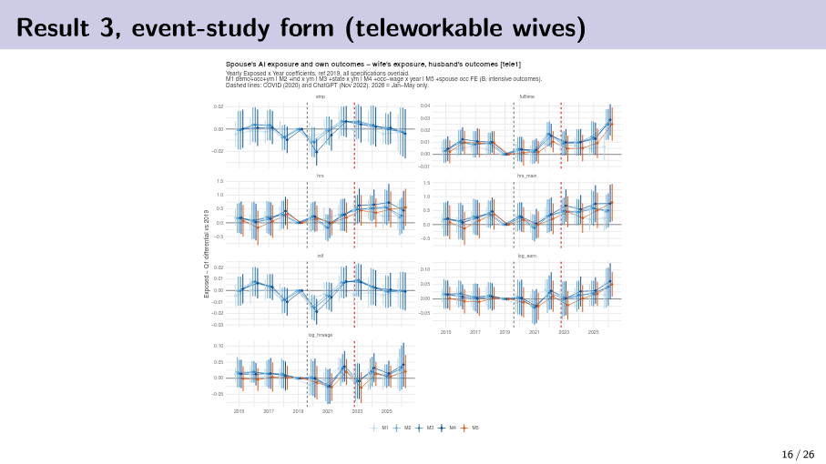
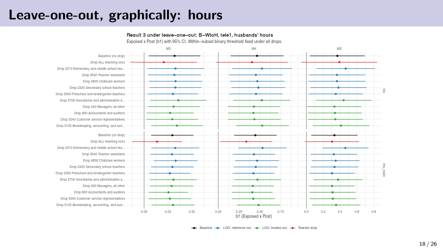

# AI Exposure and Household Labor Supply

**Sijia Chen · Work in progress**

## Project overview

How does occupational exposure to generative AI relate to workers' own labor supply and their spouses' responses? This project links married couples in the CPS and combines their occupations with generative AI exposure and teleworkability measures. It studies both own-exposure outcomes and within-household spillovers.

The September 2026 analysis uses monthly CPS data from January 2015 through May 2026. It compares exposure groups after November 2022 with a pre-COVID baseline, separately accounting for the intervening COVID period. Teleworkability is central because it is strongly correlated with AI exposure and with changes in working arrangements.

## Main findings to date

- Among couples with teleworkable wives, husbands of more AI-exposed wives work approximately **0.30 additional main-job hours per week** relative to the comparison group in the M3 specification. The estimate is **0.295 hours**, versus a pre-COVID mean of roughly 44 hours.
- This is an adjustment in hours among employed husbands, rather than clear evidence of labor-force entry. Household insurance against perceived earnings risk is one possible interpretation.
- The reference group matters: excluding teaching occupations reduces the M3 main-job estimate from **0.295 to 0.136 hours**, and it is no longer statistically significant. Estimates remain positive under additional wage-trend controls.
- Own-exposure results also differ by teleworkability. Non-teleworkable exposed husbands have lower main-job hours in M3, while exposed wives' earnings gaps already appear during the COVID period.

These are preliminary patterns, not conclusive evidence of AI-induced displacement or a causal added-worker effect. Results below consistently use the supplied September 2026 slides rather than mixing later experimental specifications.

## Key figures

### Wife's exposure and husband's outcomes



The panels show employment, participation, hours, full-time status, and earnings across specifications. The hours panels motivate the household-adjustment question. Source: slide 16.

### Sensitivity to the comparison occupations



The red estimates remove the teaching-occupation group; the other colored estimates remove individual occupations. The contrast shows why the composition of the reference group matters for interpretation. Source: slide 18; accompanying estimates on slide 17.

## Code and reproducibility

All code is organized in one directory:

```text
code/
  data_process/   # source-data cleaning and analysis-data construction
  analysis/       # final specifications, robustness checks, tables and figures
```

Start with the [code guide](docs/CODE_GUIDE.md) for the run order, source-data downloads and the mapping to the final paper/slides. [Validation](docs/VALIDATION.md) distinguishes executed checks from unresolved replication steps. [Source manifest](docs/SOURCE_MANIFEST.json) records original files and selected notebook cells.
